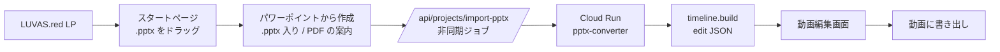
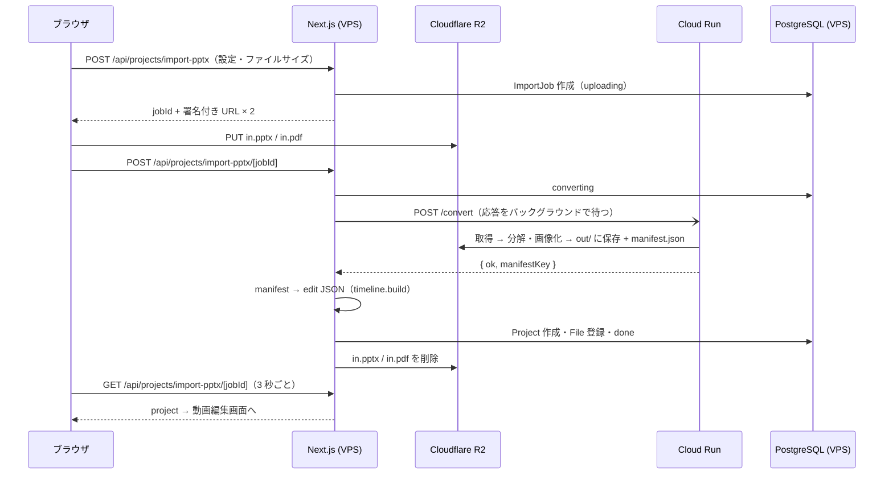

# パワーポイント→動画化ツール 設計書

> ステータス: 取り込み〜タイムライン化〜書き出しは実装済み。流入（LP・スタートページ）、ナレーション、オブジェクトメニューは未実装 / 最終更新: 2026-10-22
> 仕様の正本: Google スプレッドシート「ヒスイAI PowerPoint読み込み機能 仕様検討」（仕様表 / パワーポイントフロー / コンテツールフロー）。各項目の実装状況は仕様表の「実装状況・メモ（コード）」列にもある。

## 1. ゴール

`.pptx` と PowerPoint で書き出した PDF を読み込むだけで、スライドの見た目（フォント込み）を保ったまま
**オブジェクトごとのクリップが並んだ動画プロジェクト**を作り、動画編集画面で AI 生成・書き出しまでできるようにする。

## 2. 基本方針

- **コンテは通さない。** パワーポイント → 動画プロジェクト（Shotstack edit JSON）に直接変換する。
- 生成（画像・動画・ナレーション）は**動画編集画面**で行う。既存の `editor/generate-*` API と書き出しをそのまま使う。
- タイムライン作成は `lib/timeline.build.ts` の共通関数を使う（コンテの `to-project` と共通）。
- 重い変換処理（PDF 分解・オブジェクト画像化・LibreOffice）は **Google Cloud Run** に置き、VPS に載せない。
- アニメーションは Shotstack の**プリセット**（`transition` / `effect`）だけで再現する。キーフレーム（Tween）は使わない。

## 3. ユーザーの流れ

| 段階 | 内容 | 状況 |
|---|---|---|
| 流入 | LUVAS.red の LP → ヒスイAI のパワーポイント機能説明ページ | 未着手 |
| スタートページ | 「ここに .pptx をドラッグ」のわかりやすいページ。未ログインならログイン・新規登録へ（.pptx の引き継ぎ方は要検討） | 未着手 |
| 取り込み設定 | 「パワーポイントから作成」が **.pptx だけ入った状態**で開き、PDF の書き出し方をアナウンスする。PDF を追加し、自動アニメーションと 1 枚の秒数を選ぶ | 一部（今は .pptx と PDF を同時に選ぶ形） |
| タイムライン化 | Cloud Run で分解・画像化 → タイムライン作成 → 動画編集画面へ | 実装済み |
| 書き出し | 「動画に書き出し」＋ウォーターマークの有り無し | 実装済み |

## 4. ワークスペース

- 作成は必ずポップアップ（`components/WorkspaceBar.tsx` の `CreateWorkspaceModal`）。ツールごとの説明は `lib/workspace.api.ts` の `TOOL_TYPE_DESC`。
- `Workspace.toolType`: `"conte"` | `"pptx"`。作成後は変更不可。既存のワークスペースは `conte`。
- **コンテ→動画化は当面管理者のみ**（環境変数 `ADMIN_EMAIL`、判定は `lib/admin.ts`）。一般ユーザーには選択肢を出さず、`POST /api/workspace` でも 403。
- 新規登録時の自動作成: 管理者はコンテ用（サンプル付き）、一般ユーザーはパワーポイント用（サンプルなし）。
- パワーポイント用ワークスペースは動画編集画面のみ（コンテ作成のモード切り替えを出さない）。コンテの譲渡先に選べない。

## 5. 取り込みの処理

- Cloud Run から VPS へのコールバックは使わない。VPS が `/convert` の応答をバックグラウンドで待つ（手元の開発環境でも動くため）。
- 20 分たっても `converting` のままなら、状態確認の時点でタイムアウト扱いにする。
- R2 のキー: `user/{userId}/{workspaceId}/import/{jobId}/in/`（元ファイル、取り込み後に削除）と `.../out/`（変換結果、プロジェクトが参照するので残す）。
- 上限は仮に 1 ファイル 200MB（`IMPORT_MAX_BYTES`）。スライド枚数の上限とクレジットは未定。

## 6. 変換サービス（`converter/`、Cloud Run）

| ファイル | 役割 |
|---|---|
| `pptx_parse.py` | 表示するスライドの並び、オブジェクトの重なり順・位置・種類、プレースホルダーの位置（レイアウト・マスターから補う）、ノート、タイトル、アニメーション、画面切り替え |
| `render_pkg.py` | 「1 オブジェクト＝1 スライド」の作業用 pptx を、背景が黒と白の 2 種類作り、LibreOffice で PDF にする。文字と箇条書き記号は透明にする（グラフは除く） |
| `convert.py` | 黒白の差分で透明度を出して PNG を作る。元の PDF から文字だけを取り出して各オブジェクトに重ねる（フォント保持）。背景は JPEG |
| `main.py` | `POST /convert`（R2 経由）、`POST /convert-direct`（検証用。zip で返す）。どちらも `CONVERTER_SHARED_SECRET` で認証 |

- 埋め込み画像も LibreOffice で描画する（トリミング・角丸を保つため）。元の画像ファイルは `source` として別に保存する（AI の参照用）。
- LibreOffice のページ端は半端なピクセルになるので、外周 2px の薄い色は消す。
- 枚数・縦横比が PDF と合わなければ `SLIDE_COUNT_MISMATCH` / `PAGE_SIZE_MISMATCH`。ノートが空・形式の合わないメディアは警告。
- 失敗時の案内: コードは `ImportJob.errorCode` に保存し、画面では `lib/errorGuide.ts` の対処方法・次の操作（PDF を選び直す など）・問い合わせ先（エラーコードと受付番号＝jobId 付き）を出す。書き出しも同じ仕組み（受付番号＝renderId）。内部エラー（`INTERNAL`）は文言を一般化して `logError` に記録する。
- 出力: `manifest.json`（スライドごとの背景・オブジェクト・位置・テキスト・アニメーション・画面切り替え・警告）と画像ファイル。
- インフラ: プロジェクト `hisui-converter-512305`、サービス `pptx-converter`（asia-northeast1、2 vCPU・4 GiB、最大 3 台、同時 1 件、タイムアウト 900 秒）。サンプル 13 枚で約 35 秒。
- デプロイ: `gcloud builds submit converter --tag asia-northeast1-docker.pkg.dev/hisui-converter-512305/converter/pptx-converter:vN` → `gcloud run deploy pptx-converter --image ... --region asia-northeast1`。

## 7. タイムライン（`lib/pptx.import.ts` → `lib/timeline.build.ts`）

- 1 スライド＝1 区間。層は「背景 → オブジェクト（重なり順）」で、同じ番号の層は同じトラックに並ぶ。
- クリップの id は `pptx-s{スライド番号}-o{オブジェクトid}`（背景は `-bg`）。manifest から元の情報をたどれる。
- 位置と大きさ: `fit: "contain"`、`scale`（画面比）、`position: "center"` と中心基準の `offset`。
  - `width` / `height`（px）は書き出し解像度を変えると崩れるので使わない。
  - `position: "topLeft"` は Studio が画像の実ピクセル（画面の表示倍率で変わる）で位置を計算してずれるので使わない。
- 画角はスライドに合わせる（短い辺 1080px）。書き出しは短い辺基準で解像度を決める（`resolutionSize`）。
- スライドの長さは今は「1 枚あたりの秒数」だけ。ナレーションに合わせる処理は未実装。

## 8. アニメーション（`lib/pptx.effects.ts`）

**PowerPoint からの変換**（反映できないものはスライドごとに件数を警告）

| PowerPoint | Shotstack |
|---|---|
| 表示 | 効果なしで表示（開始時刻だけ反映） |
| フェード・ディゾルブ | `fade` |
| スライドイン・クロール・ピーク | `slide{方向}` |
| フロートイン／アウト、バウンド | `slideUp` / `slideDown` |
| ワイプ | 左右は `wipe{方向}`、上下は `reveal` |
| ブラインド・ボックス・チェッカーボード・円・ひし形・プラス・ランダムストライプ・スプリット・ストリップ・くさび形・ホイール | `reveal` |
| ズーム | `zoom` |
| 強調・軌跡 | 対応外 |

- 長さで速さを決める: 0.6 秒以下は `Fast`、1.5 秒以上は `Slow`。
- 登場は開始を遅らせて `transition.in`、退場はそこでクリップを終わらせて `transition.out`。「クリック時」はスライド開始と同時。
- 画面切り替え: フェード→`fade`、プッシュ→`carousel{方向}`、カバー→`slide{方向}`、アンカバー・形の切り替え→`reveal`、ワイプ（左右）→`wipe`、ズーム→`zoom`。背景と、登場アニメーションのないオブジェクトに付ける。前のスライドとは重ならず、黒から現れる動きになる。

**読み込み時の自動アニメーション**（PowerPoint の登場アニメーションがないオブジェクトだけ）

| 対象 | おすすめ設定 |
|---|---|
| 文字・図形（表・グラフ・SmartArt を含む） | `fadeFast`（約 0.5 秒）、動きなし |
| 埋め込み画像 | `slideUpFast`（約 0.5 秒）、`effect: zoomIn` |
| 動画・背景 | なし |

- カスタマイズ: 登場（プリセット全種類）・速さ・表示中の動き（`effect`）を選び、背景以外の文字・図形・画像・動画すべてに付ける。
- 「上から順に 1 つずつ表示」: 上（同じ高さなら左）から 0.3 秒ずつずらす。最大でスライドの長さの半分まで。
- 選択肢は `DEFAULT_IN_GROUPS` / `SPEEDS` / `DEFAULT_EFFECTS`。名前は Shotstack のスキーマで全件確認済み（transition 62 種類・effect 18 種類）。

## 9. ファイル一覧

- 取り込み完了時に、変換した画像（背景・オブジェクト・埋め込みメディア）を `File` に登録する（`registerFiles`）。ファイル名は `{スライド番号}_{オブジェクト名}`。
- ファイル一覧の画面で、取り込みのファイルをプロジェクト名のフォルダに自動で振り分ける（`components/SidePanelFiles.tsx` の `importFolder`）。
- 注意: ファイル一覧から削除すると R2 の同じファイルが消え、プロジェクトの画像も消える。削除の扱いは未定。

## 10. 書き出し

- 「ブラウザで書き出す」は廃止。「動画に書き出し」（Shotstack API）1 つ。
- ウォーターマークの有り無しトグル: 無料プランは有りで固定（「外すには有料プラン」）、有料プランは無しが初期値。設定は `videoExportSettings` の `sandboxMode`。サーバー側でも無料プランは必ず sandbox。
- 解像度は 1080p 固定（720p は使わない）。短い辺 1080px でスライドの画角に合わせる: 16:9 → 1920×1080、4:3 → 1440×1080。サーバー側（`/api/export`）でもワークスペースが pptx なら 1080p に固定する。

## 11. データ

- `Workspace.toolType String @default("conte")`
- `ImportJob`（`import_jobs`）: `status`（uploading / converting / done / error）、`options`（秒数・アニメーション設定）、`inputPrefix`（取り込み後 null）、`outPrefix`、`manifestKey`、`projectId`、`warnings`
- 環境変数: `PPTX_CONVERTER_URL`、`CONVERTER_SHARED_SECRET`（VPS 側）。Cloud Run 側は `CONVERTER_SHARED_SECRET` と `CLOUDFLARE_R2_*`（Secret Manager と環境変数）。
- DB は VPS 内の PostgreSQL。Neon は使わない。手元の開発も SSH トンネルで VPS の DB を使う（本番と共通なので、試したデータは消すこと）。

## 12. 未実装・未決

- [ ] LUVAS.red の LP と、ヒスイAI のスタートページ（.pptx のドラッグ、未ログイン時の引き継ぎ）
- [ ] .pptx を先に読み込み、PDF の書き出し方をアナウンスしてから追加してもらう流れ
- [ ] ナレーション（取り込み時の生成・一括生成・スライドの長さを合わせる・合計クレジットの表示）
- [x] 動画編集画面のクリップ操作パネル（クリップ選択時に種類別のメニュー。種類は `/api/projects/[id]/clip-kinds` が manifest から返す。`lib/clip.kind.ts`）
- [ ] クリップ操作パネルの「アニメーション変更」
- [ ] 「16:9 がよければ変更してください」のお知らせ
- [ ] ファイルサイズ・スライド枚数の上限、取り込みのクレジット
- [ ] ファイル一覧から取り込み画像を削除したときの扱い
